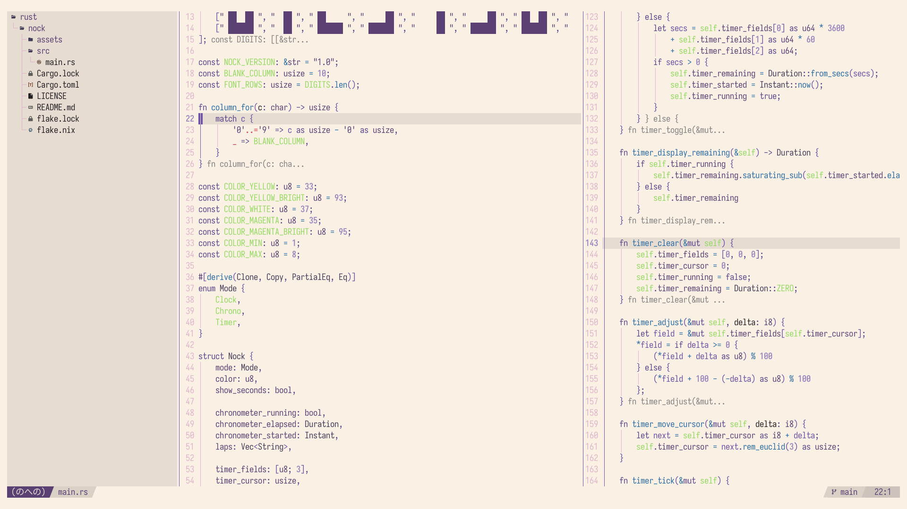

# Emiria Nvim

### Screenshot


<br></br>

### Installation

#### Lazy:
```lua 
{
    "2besita/emiria.nvim",
    lazy = false,
    priority = 1000,
}
```

<br></br>

### Usage:
Add this to your init.lua:

```lua
vim.cmd.colorscheme("emiria")
```

or simply run:

```lua
:colorscheme emiria
```

<br></br>

<p style="text-align: center;">Copyright &copy; 2026 - <a href="https://github.com/ochitsudayo" target="_blank">ochitsudayo</a></p>
